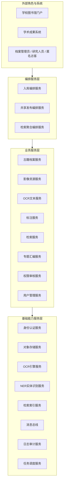
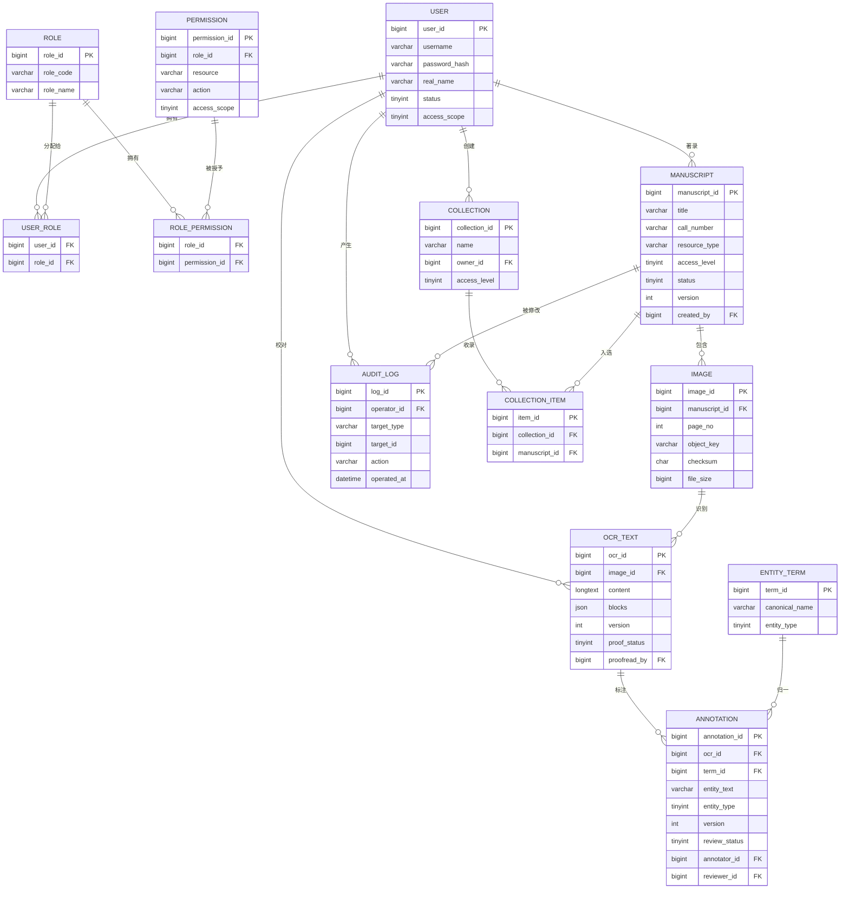
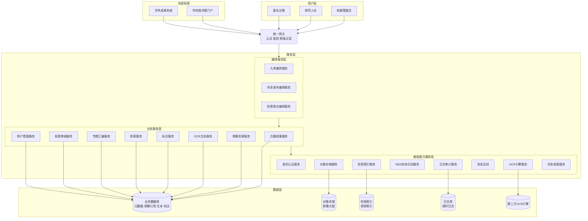
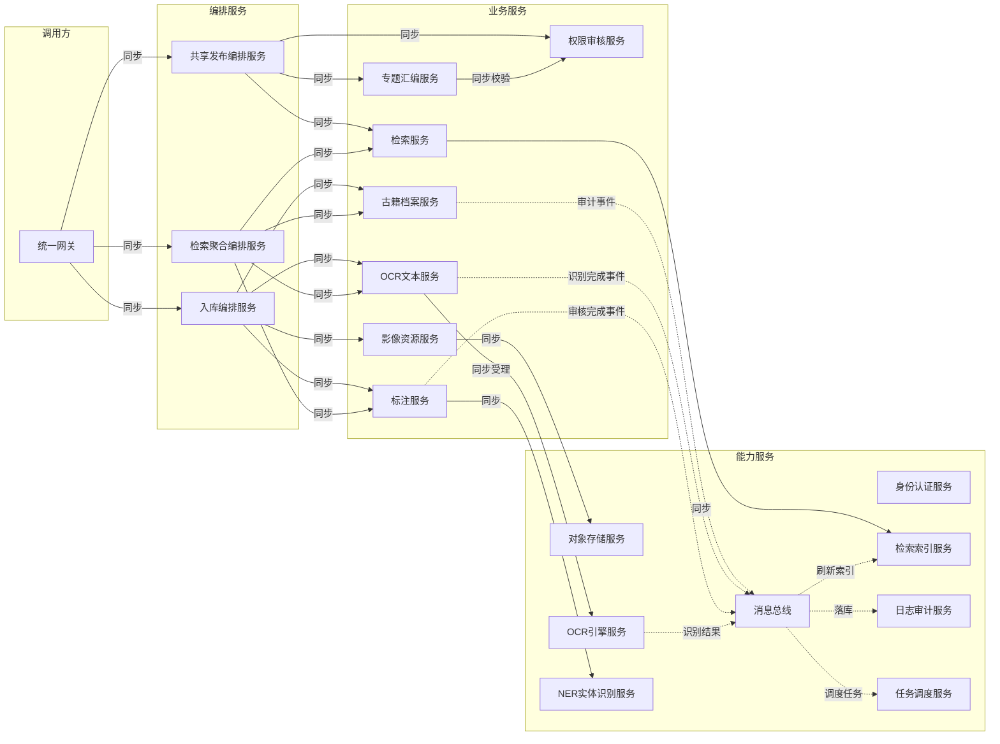
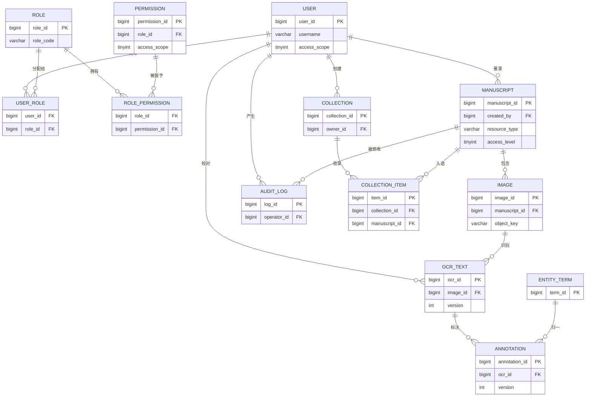

# 实验报告：面向服务架构（SOA）系统设计——古籍文献数字化平台

> 课程：信息系统分析与设计　｜　设计方法：面向服务架构（SOA）　｜　报告类型：系统设计实验
>
> **设计假设说明（全文适用）**：本报告在不引入题目未要求的微服务、容器编排等复杂技术的前提下，作如下合理假设，后续各章节均以此为前提：
> 1. 服务以独立部署的 Web API 形式提供，同步调用采用 HTTP/HTTPS + JSON，服务间通过内部网关或注册表寻址；
> 2. 异步消息采用 RabbitMQ（可替换为 Kafka），以主题/队列方式传递领域事件；
> 3. 对象存储采用兼容 S3 协议的 MinIO（可替换为腾讯云 COS、阿里云 OSS），数据库采用 MySQL 8.0；
> 4. 服务内部采用分层架构（接口层—业务层—数据访问层），每个服务独占自己的数据库 Schema；
> 5. 古籍密级用整数编码：1=开放、2=校内访问、3=涉密管控，数值越大管控越严；用户被授权的密级记为 `access_scope`，访问控制规则为 **资源 `access_level` ≤ 用户 `access_scope`**，匿名访客的 `access_scope = 1`。

---

## 第一部分　实验目的与需求分析

### 1.1 实验目的

1. 掌握面向服务架构（SOA）中服务边界划分的方法，能够按业务能力进行高内聚、低耦合的服务拆分；
2. 能够为服务设计清晰、具体、可验证的接口契约，包括输入、输出与异常返回；
3. 理解服务解耦的关键手段，能针对具体业务合理选择同步调用与消息队列异步调用；
4. 掌握从业务需求抽象 E-R 概念模型、并依照关系规范化思想转换为逻辑数据表的方法；
5. 能够针对大文件（古籍影像）设计合理的外置存储与权限一致性方案；
6. 理解权限隔离、操作留痕、可替换性等非功能需求在架构与数据层中的落地方式。

### 1.2 业务需求分析

平台围绕地方古籍文献的数字化加工与共享展开，核心业务活动包括：古籍扫描影像上传、元数据著录、OCR 识别与文本校对、人物地名实体标注与审核、文献检索、专题汇编以及成果对外共享。所有业务均需按资源密级进行访问控制，并保留完整操作痕迹。

**用户角色与权限需求分析**

| 角色 | 主要业务活动 | 可访问密级 | 关键权限约束 |
|---|---|---|---|
| 档案管理员 | 上传影像、著录与修改元数据、审核标注结果 | 1/2/3（视岗位授权） | 可变更密级与状态；所有操作强制留痕 |
| 研究人员 | OCR 文本校对、实体标注、检索、导出专题数据集 | 1/2 | 不可变更密级；导出需通过专题汇编服务的脱敏校验 |
| 匿名访客 | 公开古籍浏览、简单检索 | 1（仅开放） | 不可下载涉密/未开放文献；检索结果强制过滤 |
| 上层系统 | 调用图书馆门户、学术成果系统所需的数据与服务 | 由调用方令牌声明 | 仅经统一网关访问，按调用方密级返回数据 |

**功能性需求**：影像上传与元数据著录；OCR 识别与文本校对；实体标注、审核与归一；统一检索（含密级过滤）；专题创建与数据集导出；对外共享与上层系统对接。

**非功能性需求**：① 影像大图、OCR 文本、结构化元数据分离存储；② 三类密级严格隔离；③ OCR 与实体标注作为独立可复用能力；④ 全程操作留痕（谁、何时、修改了哪条记录）；⑤ 服务间不紧耦合，OCR 引擎与数据库可替换；⑥ 支持后续新增地方志、族谱等资源类型。

### 1.3 需求分析到设计的映射

| 需求 | 架构层响应 | 数据层响应 |
|---|---|---|
| OCR / 标注可复用、可替换 | 下沉为基础能力服务 + 适配器 | 独立 `ocr_text`、`annotation` 表并带版本字段 |
| 三类密级隔离 | 统一网关鉴权，检索服务强制注入过滤条件 | `access_level` 与 `access_scope` 比较 |
| 操作留痕 | 日志审计服务提供只追加写入接口 | `audit_log` 表记录操作者/时间/对象/类型 |
| 影像大图分离存储 | 对象存储服务提供 `objectKey` 与签名 URL | `image` 表仅存逻辑地址与校验和 |
| 后续扩展资源类型 | 档案服务用 `resource_type` + 元数据模板扩展 | `manuscript.resource_type` 字段区分类型 |

---

## 第二部分　问题一——面向服务设计

### 2.1 服务边界划分

**划分原则**

1. **按业务能力而非数据表划服务**：服务的边界对应一组内聚的业务能力，避免一个服务横跨多个不相关领域；
2. **基础能力与业务语义分离**：OCR、实体识别、存储、检索索引、鉴权、日志等技术能力不感知古籍业务语义，作为可复用能力下沉；
3. **流程控制上收到编排层**：跨服务的多步流程由编排服务负责，业务服务之间不做点对点的流程调用，避免形成调用网；
4. **数据归属明确**：每个业务服务独占自己的数据，跨服务不直接访问对方数据库，只通过契约交换数据；
5. **粒度适中**：不把每个 CRUD 都拆成一个服务，也不把检索、标注、著录混成一体的"大泥球"。

**边界划分结果**：共 19 个服务，分为基础能力服务（8 个）、业务服务（8 个）、编排服务（3 个）三层。下图给出分层关系（图中服务名称与 2.2 节清单完全一致）。



### 2.2 核心服务清单

#### （1）基础能力服务（可复用、可替换，不感知古籍业务语义）

| 服务名称 | 核心职责 | 主要功能 | 服务调用关系 |
|---|---|---|---|
| 身份认证服务 | 统一身份认证与令牌管理 | 登录校验、令牌签发/验签、单点登录对接、返回用户密级 `access_scope` | 被网关、各业务服务及编排服务调用；不主动调用其他服务 |
| 对象存储服务 | 影像二进制文件的存取 | 分片上传、断点续传、生成签名下载 URL、缩略图、对象删除 | 被影像资源服务、共享发布编排服务调用；底层对接 MinIO/S3 |
| OCR引擎服务 | 封装具体 OCR 引擎，提供统一文字识别能力 | 接收 `objectKey` 返回文本与版面块、多引擎适配、任务状态查询 | 被 OCR文本服务调用；经适配器对接第三方引擎；结果经消息总线回传 |
| NER实体识别服务 | 从文本中识别人名、地名、机构 | 实体候选识别、返回 offset 与置信度、实体类型标注 | 被标注服务调用；可被上层学术成果系统直接复用 |
| 检索索引服务 | 维护倒排索引并提供查询 | 索引写入/更新/删除、全文检索、字段过滤、密级条件过滤 | 被检索服务、入库编排服务调用；消费消息总线的索引更新事件 |
| 消息总线 | 异步事件与消息的可靠传递 | 发布/订阅、队列与主题、死信队列、重试 | 被所有需要异步解耦的服务调用；投递给日志审计、检索索引、任务调度等服务 |
| 日志审计服务 | 操作日志的可靠落库与查询 | 只追加写入日志、按操作者/对象/时间查询、防篡改校验 | 消费消息总线中的审计事件；被用户管理-related 查询场景调用 |
| 任务调度服务 | 长时异步任务的状态管理 | 任务排队、超时控制、失败重试、进度与结果回查 | 被编排服务与 OCR引擎服务使用；通过消息总线驱动任务 |

#### （2）业务服务（承载古籍业务语义，独占各自数据）

| 服务名称 | 核心职责 | 主要功能 | 服务调用关系 |
|---|---|---|---|
| 古籍档案服务 | 古籍主数据与元数据的唯一入口 | 著录、修改、版本管理、状态与密级变更、`resource_type` 模板扩展 | 调用身份认证服务验权、日志审计服务留痕；被入库编排、检索聚合编排、共享发布编排服务调用 |
| 影像资源服务 | 影像与古籍的挂接管理 | 影像登记、页码与版本管理、校验和登记、签名 URL 申请 | 调用对象存储服务；被入库编排、检索聚合编排服务调用 |
| OCR文本服务 | OCR 任务的受理、文本版本与校对 | 发起识别请求、文本版本管理、人工校对、定稿 | 调用 OCR引擎服务（同步受理+异步结果）、身份认证服务；消费消息总线的识别完成事件；被检索聚合编排服务调用 |
| 标注服务 | 实体标注的创建、修改、审核与归一 | 标注 CRUD、调用 NER 预标注、审核流转、版本记录、实体词表维护 | 调用 NER实体识别服务、身份认证服务；被入库编排、检索聚合编排服务调用 |
| 检索服务 | 面向三类角色的统一检索入口 | 组合条件检索、强制注入密级过滤、结果聚合分页 | 调用检索索引服务；被检索聚合编排服务、上层系统（经网关）调用 |
| 专题汇编服务 | 专题组织与数据集导出 | 专题 CRUD、成员管理、导出前脱敏与权限校验、生成数据集 | 调用权限审核服务校验、身份认证服务；被共享发布编排服务调用 |
| 权限审核服务 | 授权模型与审核工作流 | 角色-权限解析、密级判定、标注审核流流转 | 调用身份认证服务；被专题汇编、共享发布编排、标注服务调用 |
| 用户管理服务 | 用户档案的维护与查询 | 用户 CRUD、角色分配、用户状态管理（不含操作日志） | 调用身份认证服务、日志审计服务；调用关系与日志审计服务区分：本服务管"用户"，日志审计服务管"操作记录" |

#### （3）编排服务（跨服务流程，不含领域数据）

| 服务名称 | 核心职责 | 主要功能 | 服务调用关系 |
|---|---|---|---|
| 入库编排服务 | 编排影像入库到可检索的全过程 | 上传登记→OCR→NER 预标注→建索引→置为待审，用 Saga 补偿保证最终一致 | 顺序/异步调用影像资源、OCR文本、标注、检索索引服务；通过消息总线驱动异步步骤 |
| 共享发布编排服务 | 面向上层系统的成果整合与发布 | 按调用方密级聚合数据、脱敏、生成对外数据集与接口响应 | 调用检索服务、专题汇编服务、权限审核服务；经身份认证服务校验调用方 |
| 检索聚合编排服务 | 聚合一次检索所需的多种数据 | 合并元数据、OCR 文本、标注、影像签名 URL，屏蔽内部服务拓扑 | 调用古籍档案、OCR文本、标注、影像资源、检索服务；作为网关后的统一查询入口 |

> **扩展性说明**：新增地方志、族谱时，古籍档案服务通过 `resource_type` 字段区分类型并加载不同元数据模板即可，入库编排与共享发布流程无需修改；OCR 识别与标注能力本身与资源类型无关，直接复用。

### 2.3 服务接口契约

本节选取两个代表性服务：**OCR引擎服务**（基础能力服务，体现可替换性）与**古籍档案服务**（业务服务，体现密级与留痕）。

#### 接口一：OCR引擎服务

| 项目 | 内容 |
|---|---|
| 服务名称 | OCR引擎服务 |
| 接口名称及用途 | 影像文字识别接口——接收影像的逻辑引用，返回 OCR 文本与版面块坐标；供 OCR文本服务及上层学术成果系统调用 |
| 请求方式 | POST |
| 接口路径 | `/ocr/v1/recognize` |

**输入参数**

| 参数名 | 类型 | 必填 | 说明 |
|---|---|---|---|
| `requestId` | string | 是 | 请求唯一标识，用于幂等与链路追踪 |
| `objectKey` | string | 是 | 对象存储中的影像逻辑地址，如 `scan/2026/guji-0031/p0015.tif` |
| `options.lang` | string | 否 | 识别语言，默认 `zh-Hans` |
| `options.layout` | boolean | 否 | 是否做版面分析，默认 true |
| `options.returnBox` | boolean | 否 | 是否返回行块 bbox 坐标，默认 true |
| `options.engine` | string | 否 | 引擎选择，`auto` 表示按配置默认引擎 |
| `options.callback` | string | 否 | 异步结果回传的队列地址 |

**输出参数（同步受理）**

| 参数名 | 类型 | 说明 |
|---|---|---|
| `requestId` | string | 回显请求标识 |
| `taskId` | string | 识别任务 ID，用于回查 |
| `status` | string | `ACCEPTED` 表示已受理 |
| `pollUrl` | string | 任务状态回查地址 |
| `estimatedSec` | int | 预计耗时（秒） |

**输出参数（异步结果消息）**

| 参数名 | 类型 | 说明 |
|---|---|---|
| `taskId` | string | 任务 ID |
| `status` | string | `SUCCEEDED` / `FAILED` |
| `engineVersion` | string | 实际使用的引擎版本，便于追溯 |
| `text` | string | 识别出的全文 |
| `blocks` | array | 行块数组，每项含 `page`、`bbox`、`text`、`confidence` |
| `finishedAt` | datetime | 完成时间 |

**异常返回**

| code | HTTP | 含义 | 可重试 |
|---|---|---|---|
| `IMAGE_UNREADABLE` | 422 | 影像不存在、校验和不匹配或无法解码 | 否 |
| `ENGINE_BUSY` | 503 | 引擎线程池满 | 是 |
| `UNSUPPORTED_LANG` | 400 | 不支持的语言参数 | 否 |
| `QUOTA_EXCEEDED` | 429 | 调用配额超限 | 是 |

**请求与响应示例（JSON 风格）**

```jsonc
// 请求 POST /ocr/v1/recognize
{
  "requestId": "req-8f3c21",
  "objectKey": "scan/2026/guji-0031/p0015.tif",
  "options": {
    "lang": "zh-Hans", "layout": true, "returnBox": true,
    "engine": "auto", "callback": "mq://ocr.result.v1"
  }
}

// 同步受理响应
{
  "requestId": "req-8f3c21", "taskId": "ocr-9d21", "status": "ACCEPTED",
  "pollUrl": "/ocr/v1/tasks/ocr-9d21", "estimatedSec": 40
}

// 异步结果消息
{
  "taskId": "ocr-9d21", "status": "SUCCEEDED", "engineVersion": "PaddleOCR-3.0",
  "text": "……",
  "blocks": [{ "page": 1, "bbox": [120,304,1680,352], "text": "……", "confidence": 0.96 }],
  "finishedAt": "2026-11-20T17:25:10+08:00"
}

// 异常响应
{
  "requestId": "req-8f3c21",
  "error": { "code": "IMAGE_UNREADABLE", "message": "影像无法解码",
             "detail": "objectKey 不存在或校验和不匹配", "retryable": false }
}
```

#### 接口二：古籍档案服务

| 项目 | 内容 |
|---|---|
| 服务名称 | 古籍档案服务 |
| 接口名称及用途 | 更新古籍元数据接口——修改题名、朝代及密级等字段，并执行乐观锁校验与操作留痕 |
| 请求方式 | PATCH |
| 接口路径 | `/archive/v1/manuscripts/{manuscriptId}` |

**输入参数**

| 参数名 | 类型 | 必填 | 说明 |
|---|---|---|---|
| `manuscriptId`（路径） | string | 是 | 古籍编号，如 `M20260031` |
| `requestId` | string | 是 | 请求唯一标识 |
| `actor.userId` | long | 是 | 操作者用户 ID，用于留痕 |
| `actor.role` | string | 是 | 操作者角色，如 `ARCHIVIST` |
| `expectedVersion` | int | 是 | 客户端持有的版本号，用于乐观锁 |
| `patch.title` | string | 否 | 新题名 |
| `patch.dynasty` | string | 否 | 新朝代 |
| `patch.accessLevel` | string | 否 | 新密级：`OPEN`/`CAMPUS`/`CONFIDENTIAL` |
| `reason` | string | 否 | 修改原因，写入审计日志 |

**输出参数**

| 参数名 | 类型 | 说明 |
|---|---|---|
| `manuscriptId` | string | 古籍编号 |
| `version` | int | 更新后的版本号 |
| `accessLevel` | string | 更新后的密级 |
| `updatedAt` | datetime | 更新时间 |
| `auditLogId` | string | 本次操作生成的日志 ID |
| `links.images` | string | 关联影像资源接口的 URL |

**异常返回**

| code | HTTP | 含义 | 可重试 |
|---|---|---|---|
| `VERSION_CONFLICT` | 409 | 记录已被他人修改，返回 `currentVersion` | 是（重新读取后再提交） |
| `PERMISSION_DENIED` | 403 | 角色无权变更密级 | 否 |
| `INVALID_FIELD` | 400 | 字段值不合法 | 否 |
| `RESOURCE_NOT_FOUND` | 404 | 古籍不存在 | 否 |

**请求与响应示例（JSON 风格）**

```jsonc
// 请求 PATCH /archive/v1/manuscripts/M20260031
{
  "requestId": "req-c41a07",
  "actor": { "userId": 1024, "role": "ARCHIVIST" },
  "expectedVersion": 6,
  "patch": { "title": "重修XX县志·卷三", "dynasty": "清", "accessLevel": "CAMPUS" },
  "reason": "校勘题名，按校内访问级别开放"
}

// 成功响应
{
  "manuscriptId": "M20260031", "version": 7, "accessLevel": "CAMPUS",
  "updatedAt": "2026-11-20T17:26:03+08:00", "auditLogId": "LOG-88f10",
  "links": { "images": "/image/v1/manuscripts/M20260031/images" }
}

// 异常响应
{
  "requestId": "req-c41a07",
  "error": { "code": "VERSION_CONFLICT", "message": "记录已被他人修改",
             "currentVersion": 8, "retryable": true }
}
```

> 设计要点：`expectedVersion` 实现乐观锁，解决并发著录冲突；`actor` 与返回的 `auditLogId` 对应，落实"谁、何时、修改了哪条记录"的留痕要求。

### 2.4 服务解耦与通信机制

#### 2.4.1 各服务如何实现低耦合

1. **数据私有**：每个业务服务独占自己的数据库 Schema，禁止跨库 JOIN。例如标注服务不直接读 `manuscript` 表，而通过古籍档案服务接口获取题名与密级。
2. **契约优先**：服务之间只依赖稳定契约（接口路径、参数、错误码），不依赖对方实现；契约版本化（如 `/v1/`）支持独立升级。
3. **编排集中**：跨服务流程由编排服务负责。以入库为例，入库编排服务依次调用影像登记、OCR、预标注、建索引，业务服务彼此不知对方存在。
4. **事件驱动**：领域事件（`ManuscriptCreated`、`OcrCompleted`、`AnnotationReviewed`）发布到消息总线，索引刷新、审计落库等后续动作由订阅方自行处理，发布方无需知道订阅者。
5. **统一入口**：外部系统与前端只访问统一网关，由网关完成身份认证与密级过滤，内部服务拓扑对调用方不可见。

#### 2.4.2 通过统一接口进行服务调用

所有同步调用遵循统一的 REST 约定：资源化路径 `/{服务}/{版本}/{资源}`、JSON 报文、统一错误结构 `{requestId, error:{code, message, retryable}}`、统一幂等键 `requestId`。例如检索聚合编排服务调用古籍档案服务取元数据、调用 OCR文本服务取校对文本，使用的是同一套报文与错误规范，调用方可以用统一的客户端拦截器处理重试、超时与熔断，从而不必针对不同服务编写适配代码。

#### 2.4.3 通过适配器隔离第三方 OCR 引擎

在 OCR引擎服务内部定义统一接口（以伪代码表示）：

```java
public interface OcrAdapter {
    OcrResult recognize(String objectKey, OcrOptions options);
    String version();
}
```

针对不同引擎实现 `PaddleOcrAdapter`、`TesseractAdapter` 等，各自完成"影像获取→引擎调用→结果归一化（统一为 `text` + `blocks[page,bbox,text,confidence]`）"。服务通过配置 `ocr.engine.active=paddle` 与简单工厂选择具体实现，业务代码只依赖 `OcrAdapter` 接口。因此更换 OCR 引擎时只需新增一个适配器类并修改配置，OCR文本服务及上层调用方无需任何改动，满足"未来可替换 OCR 引擎"的约束。同理，对象存储也通过 `StorageAdapter` 隔离 MinIO 与 S3。

#### 2.4.4 数据库访问与业务逻辑分离

每个服务内部采用三层结构：**接口层**（参数校验、鉴权、错误码映射）→ **业务层**（领域规则，如密级判定、版本冲突处理、审核流转）→ **数据访问层**（Repository/DAO，封装 SQL 与 ORM 映射）。业务层依赖数据访问层的抽象接口，通过依赖注入获得实现，不直接书写 SQL。这样：① 更换数据库（如 MySQL 换 PostgreSQL）只需替换数据访问层实现与方言配置，业务规则不变；② 单元测试可用内存仓储替身验证业务逻辑，无需真实数据库。

#### 2.4.5 同步与异步调用的场景选择（结合本平台举例）

| 业务场景 | 调用方式 | 原因 |
|---|---|---|
| 元数据著录、密级变更、标注审核提交 | 同步 HTTP | 用户需立即知道成功或失败，且需返回新版本号；操作短小，强一致要求高 |
| 登录鉴权、角色密级解析 | 同步 HTTP | 是每次请求的必经前置步骤，必须低延迟并返回明确结果 |
| 公开浏览、简单检索、上层系统读数据 | 同步（经网关与检索聚合编排） | 调用方在等待响应，需即时返回结果 |
| OCR 识别、批量 NER 预标注 | 消息队列异步 | 单页识别耗时数十秒，大批量更久；同步会导致 HTTP 超时与线程堆积，异步可削峰、可重试 |
| 专题数据集导出 | 消息队列异步 | 打包与脱敏耗时且占资源，后台任务完成后通知用户下载 |
| 入库流程的多步骤衔接 | 事件驱动异步 | 跨服务最终一致，发布方不需知道后续订阅者，便于扩展新步骤 |
| 审核通过后刷新检索索引、写入操作日志 | 消息异步 | 与主业务解耦，避免主流程因索引/日志故障而失败；日志用本地事务表+可靠投递保证不丢失 |

**两种方式对比**：同步调用链路清晰、易于理解与调试、适合即时一致性场景，但调用方被阻塞、下游故障易沿链路传播、不适合长耗时任务；异步调用解耦上下游、可削峰填谷、失败可重试重试、提升整体可用性，但带来最终一致性与消息重复/乱序问题，需通过幂等键、消费者去重与补偿事务（Saga）处理。本平台据此将"用户交互型、即时可读型"操作用同步，将"耗时计算型、跨服务通知型"操作用异步。

---

## 第三部分　问题二——数据层设计

### 3.1 E-R 概念模型

#### 3.1.1 实体及属性（PK 主键，FK 外键）

| 实体名称 | 主要属性 | 主键 | 外键 |
|---|---|---|---|
| 古籍 MANUSCRIPT | 古籍编号、题名、责任者、馆藏号、朝代、版本、资源类型、密级、状态、版本号、创建人 | `manuscript_id` | `created_by` → USER |
| 影像 IMAGE | 影像编号、页码、对象存储地址、校验和、宽、高、文件大小、上传时间 | `image_id` | `manuscript_id` → MANUSCRIPT |
| OCR文本 OCR_TEXT | 文本编号、内容、行块坐标、版本号、识别引擎、校对状态、校对人、更新时间 | `ocr_id` | `image_id` → IMAGE，`proofread_by` → USER |
| 实体标注 ANNOTATION | 标注编号、实体原文、实体类型、起止偏移、置信度、版本号、审核状态、标注人、审核人 | `annotation_id` | `ocr_id` → OCR_TEXT，`term_id` → ENTITY_TERM，`annotator_id`/`reviewer_id` → USER |
| 实体词表 ENTITY_TERM | 词表编号、标准名、别名、实体类型 | `term_id` | — |
| 用户 USER | 用户编号、用户名、密码摘要、姓名、状态、可访问密级 | `user_id` | — |
| 角色 ROLE | 角色编号、角色编码、角色名称 | `role_id` | — |
| 权限 PERMISSION | 权限编号、资源、操作、可访问密级上限 | `permission_id` | `role_id` → ROLE |
| 用户角色 USER_ROLE | 用户编号、角色编号 | (`user_id`, `role_id`) | 两者分别 → USER、ROLE |
| 角色权限 ROLE_PERMISSION | 角色编号、权限编号 | (`role_id`, `permission_id`) | 两者分别 → ROLE、PERMISSION |
| 操作日志 AUDIT_LOG | 日志编号、操作者、目标类型、目标编号、动作、变更前、变更后、操作时间、IP | `log_id` | `operator_id` → USER |
| 专题 COLLECTION | 专题编号、名称、说明、创建人、密级 | `collection_id` | `owner_id` → USER |
| 专题条目 COLLECTION_ITEM | 条目编号、专题编号、古籍编号 | `item_id` | `collection_id` → COLLECTION，`manuscript_id` → MANUSCRIPT |

#### 3.1.2 实体联系及基数

| 联系 | 涉及实体 | 基数 | 说明 |
|---|---|---|---|
| 著录 | USER — MANUSCRIPT | 一对多（1:N） | 一个用户可著录多部古籍，一部古籍由一个用户创建 |
| 包含 | MANUSCRIPT — IMAGE | 一对多（1:N） | 一部古籍含多页影像 |
| 识别 | IMAGE — OCR_TEXT | 一对多（1:N） | 一页影像可有多次识别/校对版本 |
| 标注 | OCR_TEXT — ANNOTATION | 一对多（1:N） | 一个文本版本含多条标注 |
| 归一 | ENTITY_TERM — ANNOTATION | 一对多（1:N） | 一个规范词可对应多条实体标注 |
| 拥有 | USER — ROLE | 多对多（N:M） | 经 USER_ROLE 分解 |
| 授予 | ROLE — PERMISSION | 多对多（N:M） | 经 ROLE_PERMISSION 分解 |
| 产生 | USER — AUDIT_LOG | 一对多（1:N） | 一个用户产生多条日志 |
| 被修改 | MANUSCRIPT — AUDIT_LOG | 一对多（1:N） | 一部古籍对应多条修改记录 |
| 创建 | USER — COLLECTION | 一对多（1:N） | 一个用户可创建多个专题 |
| 收录 | COLLECTION — COLLECTION_ITEM | 一对多（1:N） | 一个专题含多个条目 |
| 入选 | MANUSCRIPT — COLLECTION_ITEM | 一对多（1:N） | 一部古籍可属于多个专题条目，专题与古籍整体为多对多（N:M） |
| 校对 | USER — OCR_TEXT | 一对多（1:N） | 一个用户可校对多个文本版本 |

#### 3.1.3 E-R 图（Mermaid）



### 3.2 核心数据表设计

> 类型以 MySQL 8.0 为例。`access_level` / `access_scope`：1=开放、2=校内访问、3=涉密管控；各表统一含 `created_at`、`updated_at`（DATETIME，非空，此处从略）。"是否为空"列中"否"表示 `NOT NULL`。

#### 表 1　古籍主表 `manuscript`

| 字段名称 | 数据类型 | 主键/外键 | 是否为空 | 索引 | 字段说明 |
|---|---|---|---|---|---|
| `manuscript_id` | BIGINT | PK | 否 | 主键索引 | 古籍编号，自增 |
| `title` | VARCHAR(200) | — | 否 | FULLTEXT(`title`,`call_number`) | 题名 |
| `call_number` | VARCHAR(64) | — | 否 | UNIQUE | 馆藏号，唯一 |
| `resource_type` | VARCHAR(24) | — | 否 | 联合索引(`resource_type`,`access_level`,`status`) | 古籍/地方志/族谱，支持扩展 |
| `author` | VARCHAR(100) | — | 是 | — | 责任者 |
| `dynasty` | VARCHAR(40) | — | 是 | — | 朝代 |
| `edition` | VARCHAR(100) | — | 是 | — | 版本 |
| `access_level` | TINYINT | — | 否 | 联合索引、单列索引 | 密级：1/2/3，默认 3 |
| `status` | TINYINT | — | 否 | 联合索引 | 著录中/待审/已发布/已下架 |
| `version` | INT | — | 否 | — | 乐观锁版本号，默认 1 |
| `created_by` | BIGINT | FK→USER.user_id | 否 | — | 著录人 |

#### 表 2　影像文件表 `image`

| 字段名称 | 数据类型 | 主键/外键 | 是否为空 | 索引 | 字段说明 |
|---|---|---|---|---|---|
| `image_id` | BIGINT | PK | 否 | 主键索引 | 影像编号 |
| `manuscript_id` | BIGINT | FK→MANUSCRIPT | 否 | UNIQUE(`manuscript_id`,`page_no`)、普通索引(`manuscript_id`) | 所属古籍 |
| `page_no` | INT | — | 否 | 联合唯一索引 | 页码 |
| `object_key` | VARCHAR(255) | — | 否 | — | 对象存储逻辑地址，非二进制 |
| `checksum` | CHAR(64) | — | 否 | 普通索引 | SHA-256 校验和，用于去重与完整性校验 |
| `width` | INT | — | 是 | — | 像素宽 |
| `height` | INT | — | 是 | — | 像素高 |
| `file_size` | BIGINT | — | 否 | — | 文件字节数 |

#### 表 3　OCR 文本表 `ocr_text`（支持版本管理）

| 字段名称 | 数据类型 | 主键/外键 | 是否为空 | 索引 | 字段说明 |
|---|---|---|---|---|---|
| `ocr_id` | BIGINT | PK | 否 | 主键索引 | 文本编号 |
| `image_id` | BIGINT | FK→IMAGE | 否 | UNIQUE(`image_id`,`version`)、普通索引(`image_id`,`proof_status`) | 对应影像 |
| `version` | INT | — | 否 | 联合唯一索引 | 第 N 次识别或校对版本 |
| `content` | LONGTEXT | — | 否 | FULLTEXT(`content`) | OCR 全文 |
| `blocks` | JSON | — | 是 | — | 行块及 bbox 坐标 |
| `engine` | VARCHAR(50) | — | 是 | — | 识别引擎及版本，便于追溯 |
| `proof_status` | TINYINT | — | 否 | 联合索引 | 待校对/已校对/已定稿 |
| `proofread_by` | BIGINT | FK→USER.user_id | 是 | — | 校对人 |

#### 表 4　标注记录表 `annotation`（支持版本与审核）

| 字段名称 | 数据类型 | 主键/外键 | 是否为空 | 索引 | 字段说明 |
|---|---|---|---|---|---|
| `annotation_id` | BIGINT | PK | 否 | 主键索引 | 标注编号 |
| `ocr_id` | BIGINT | FK→OCR_TEXT | 否 | 普通索引(`ocr_id`,`start_offset`) | 所属 OCR 文本版本 |
| `term_id` | BIGINT | FK→ENTITY_TERM | 是 | 联合索引(`entity_type`,`term_id`) | 归一到的规范词 |
| `entity_text` | VARCHAR(100) | — | 否 | — | 实体原文 |
| `entity_type` | TINYINT | — | 否 | 联合索引 | 1=人名、2=地名、3=机构 |
| `start_offset` | INT | — | 否 | 联合索引(`ocr_id`,`start_offset`) | 实体在文本中的起始偏移 |
| `end_offset` | INT | — | 否 | — | 结束偏移 |
| `confidence` | DECIMAL(4,3) | — | 是 | — | 识别置信度 |
| `version` | INT | — | 否 | 普通索引 | 标注版本号，支持修改留痕 |
| `review_status` | TINYINT | — | 否 | 普通索引 | 待审/通过/驳回 |
| `annotator_id` | BIGINT | FK→USER.user_id | 否 | — | 标注人 |
| `reviewer_id` | BIGINT | FK→USER.user_id | 是 | — | 审核人 |

#### 表 5　用户权限表组

**5.1 用户表 `user`**

| 字段名称 | 数据类型 | 主键/外键 | 是否为空 | 索引 | 字段说明 |
|---|---|---|---|---|---|
| `user_id` | BIGINT | PK | 否 | 主键索引 | 用户编号 |
| `username` | VARCHAR(64) | — | 否 | UNIQUE | 登录名，唯一 |
| `password_hash` | VARCHAR(255) | — | 否 | — | 密码摘要 |
| `real_name` | VARCHAR(64) | — | 是 | — | 姓名 |
| `status` | TINYINT | — | 否 | 普通索引 | 启用/停用 |
| `access_scope` | TINYINT | — | 否 | — | 可访问密级上限：1/2/3，访客为 1 |

**5.2 角色表 `role`**

| 字段名称 | 数据类型 | 主键/外键 | 是否为空 | 索引 | 字段说明 |
|---|---|---|---|---|---|
| `role_id` | BIGINT | PK | 否 | 主键索引 | 角色编号 |
| `role_code` | VARCHAR(32) | — | 否 | UNIQUE | ARCHIVIST/RESEARCHER/GUEST 等 |
| `role_name` | VARCHAR(64) | — | 否 | — | 角色名称 |

**5.3 权限表 `permission`**

| 字段名称 | 数据类型 | 主键/外键 | 是否为空 | 索引 | 字段说明 |
|---|---|---|---|---|---|
| `permission_id` | BIGINT | PK | 否 | 主键索引 | 权限编号 |
| `role_id` | BIGINT | FK→ROLE.role_id | 否 | 普通索引 | 所属角色 |
| `resource` | VARCHAR(64) | — | 否 | 联合索引(`role_id`,`resource`) | 资源类型，如 manuscript、annotation |
| `action` | VARCHAR(32) | — | 否 | — | 操作，如 read、update、export |
| `access_scope` | TINYINT | — | 否 | — | 该权限允许访问的最高密级 |

**5.4 用户角色关联表 `user_role`**

| 字段名称 | 数据类型 | 主键/外键 | 是否为空 | 索引 | 字段说明 |
|---|---|---|---|---|---|
| `user_id` | BIGINT | PK(联合)、FK→USER | 否 | 联合主键、普通索引(`role_id`) | 用户编号 |
| `role_id` | BIGINT | PK(联合)、FK→ROLE | 否 | 联合主键 | 角色编号 |

**5.5 角色权限关联表 `role_permission`**

| 字段名称 | 数据类型 | 主键/外键 | 是否为空 | 索引 | 字段说明 |
|---|---|---|---|---|---|
| `role_id` | BIGINT | PK(联合)、FK→ROLE | 否 | 联合主键 | 角色编号 |
| `permission_id` | BIGINT | PK(联合)、FK→PERMISSION | 否 | 联合主键、普通索引(`permission_id`) | 权限编号 |

> **三类密级的落地**：鉴权时先由 `user_role`/`role_permission` 解析出用户的权限及 `access_scope`，再与 `manuscript.access_level` 比较（要求 `access_level ≤ access_scope`）；`permission.access_scope` 限制该权限可触及的最高密级，访客仅 `access_scope = 1`，因此检索服务为其注入 `access_level = 1` 的过滤条件，涉密与校内文献不返回。

#### 表 6　操作日志表 `audit_log`

| 字段名称 | 数据类型 | 主键/外键 | 是否为空 | 索引 | 字段说明 |
|---|---|---|---|---|---|
| `log_id` | BIGINT | PK | 否 | 主键索引 | 日志编号 |
| `operator_id` | BIGINT | FK→USER.user_id | 否 | 联合索引(`operator_id`,`operated_at`) | **谁**：操作者 |
| `target_type` | VARCHAR(24) | — | 否 | 联合索引(`target_type`,`target_id`) | **哪类对象**：manuscript/annotation 等 |
| `target_id` | BIGINT | — | 否 | 联合索引 | **哪条记录**：目标主键 |
| `action` | VARCHAR(32) | — | 否 | — | **操作类型**：CREATE/UPDATE/REVIEW 等 |
| `before_data` | JSON | — | 是 | — | 变更前快照 |
| `after_data` | JSON | — | 是 | — | 变更后快照 |
| `operated_at` | DATETIME(3) | — | 否 | 联合索引 | **何时**：操作时间，毫秒精度 |
| `ip` | VARCHAR(45) | — | 是 | — | 来源 IP |
| `trace_id` | VARCHAR(64) | — | 是 | — | 链路追踪 ID |

该表只追加、不更新、不删除，可配合归档表或哈希链增强防篡改性。

#### 补充表

- **实体词表 `entity_term`**：`term_id` BIGINT PK、`canonical_name` VARCHAR(100) NOT NULL、`entity_type` TINYINT NOT NULL、`alias` VARCHAR(255)；唯一索引(`canonical_name`,`entity_type`)。
- **专题表 `collection`**：`collection_id` BIGINT PK、`name` VARCHAR(200) NOT NULL、`description` TEXT、`owner_id` BIGINT FK→USER、`access_level` TINYINT NOT NULL；索引(`owner_id`)。
- **专题条目表 `collection_item`**：`item_id` BIGINT PK、`collection_id` BIGINT FK→COLLECTION NOT NULL、`manuscript_id` BIGINT FK→MANUSCRIPT NOT NULL；UNIQUE(`collection_id`,`manuscript_id`)、索引(`manuscript_id`)。

> **规范化说明**：影像、OCR 文本、元数据三表分离，可各自独立演进；实体原文与规范词分开（`annotation` / `entity_term`），避免同名异写冗余；权限采用标准 RBAC 三范式。OCR 文本与标注均设 `version` 字段并配合联合唯一索引，满足"支持版本管理或修改记录"的要求。

### 3.3 影像文件存储方案

**3.3.1 大文件存储对数据库性能的影响**

单张古籍扫描大图通常为数十至数百 MB，一部古籍可达数 GB，而一条元数据仅数百字节。若把影像以 BLOB 存入数据库：① 数据页被大对象占满，缓冲池命中率骤降，元数据查询（著录列表、检索）的 I/O 放大；② 数据库备份窗口、磁盘占用与主从复制带宽随影像总量线性膨胀；③ 大事务与长锁影响并发；④ 影像的流量特征（流式、顺序读）与数据库的随机访问优势不匹配。因此影像不应进入业务数据库。

**3.3.2 数据库与文件存储系统各自适合存放的内容**

| 存储系统 | 适合存放 | 不适合存放 |
|---|---|---|
| 关系数据库（MySQL） | 元数据、版本号、密级、主键外键关系、索引字段、操作日志、影像的引用地址与校验和 | 影像二进制、OCR 长文本的批量内容分发 |
| 对象存储（MinIO/S3） | 影像大图、缩略图、派生文件；提供分片上传、断点续传、生命周期归档、签名 URL、CDN 对接 | 需要事务与复杂关联查询的元数据 |

分工原则：数据库管"是什么、属于谁、什么密级"，对象存储管"文件字节在哪"，OCR 文本因需全文检索与版本校对，独立存于数据库中的 `ocr_text` 表（其大字段与元数据表分离，也避免拖累主表查询）。

**3.3.3 通过路径/对象存储地址建立关联**

`image` 表保存 `object_key`（如 `scan/2026/guji-0031/p0015.tif`）、`checksum`、`file_size`、宽高等元数据，`object_key` 即影像在对象存储中的逻辑地址。上传流程为：先向对象存储服务申请上传凭证并上传文件，成功后将 `object_key` 与校验和登记入 `image` 表；下载时由影像资源服务先查 `image` 表得到 `object_key`，再向对象存储服务申请**带有效期的签名 URL** 返回给前端。更换存储厂商时只需迁移对象并批量更新 `object_key` 前缀，表结构不变。

**3.3.4 保证文件访问权限与古籍资源权限一致**

关键原则是**签名 URL 的签发必须以资源密级校验为前提**：① 任何影像下载请求都先经统一网关的身份认证，得到用户 `access_scope`；② 影像资源服务按 `image.manuscript_id` 查到古籍的 `access_level`，仅当 `access_level ≤ access_scope` 时才签发签名 URL，涉密或校内文献对无权限者直接拒绝；③ 签名 URL 设置短有效期（如 5 分钟）且绑定请求来源，防止转发扩散；④ 对象存储桶策略设为私有，禁止公开读，仅允许服务端签名访问；⑤ 涉密影像可置于独立 bucket 并启用加密与访问审计，与开放资源物理隔离；⑥ 检索服务返回结果时同步应用密级过滤，未授权文献的影像条目根本不出现在结果中，从入口到文件两层把关，确保权限一致。

---

## 第四部分　系统架构图

> 以下三图均使用 Mermaid 语法，可直接复制到 Mermaid Live Editor 运行。图中服务名称与第 2.2 节清单严格一致。

### 4.1 系统总体架构图

展现用户层、服务层（编排/业务/能力三个子层）、数据层与外部系统的关系；可见只有业务服务访问各自数据库，能力服务访问对象存储/索引/日志，编排服务不直接访问数据库。



### 4.2 SOA 服务关系图

实线箭头表示同步调用，虚线箭头表示经消息总线的异步消息；编排服务只调用业务/能力服务，不直接访问数据库。



### 4.3 E-R 图

与第 3.1 节实体、主外键及基数一一对应。



---

## 第五部分　总结

本实验围绕地方古籍文献数字化平台，完成了面向服务架构与配套数据层的完整设计。

**在服务设计方面**，按业务能力将平台拆分为基础能力服务、业务服务、编排服务三层共 19 个服务，明确了每个服务的核心职责、主要功能与调用关系，避免了职责重叠与粒度过细。选取 OCR引擎服务与古籍档案服务设计了包含请求方式、路径、参数表、异常码和 JSON 示例的具体接口契约。针对解耦，提出了数据私有、契约优先、编排集中、事件驱动与统一网关五项手段，并通过适配器模式隔离第三方 OCR 引擎、通过三层结构实现数据库访问与业务逻辑分离；结合入库、OCR、检索、导出等实际业务，论证了"交互即时型用同步、耗时计算型用异步"的选择依据。

**在数据层设计方面**，抽象出 13 个实体并给出属性、主外键与联系基数，绘制了与之一致的 E-R 图；设计了古籍主表、影像文件表、OCR 文本表、标注记录表、用户权限表组、操作日志表等核心数据表，逐字段给出数据类型、主外键、非空约束与检索索引，满足三类密级隔离、操作留痕以及 OCR/标注版本管理的要求。针对影像大图，论证了外置对象存储的必要性，并给出以 `object_key` 关联、"签名 URL 签发前校验密级"的权限一致性方案。

**设计的一致性与可行性**：报告中的服务名称在架构图、服务清单与服务关系图中保持一致；实体、字段与索引在 E-R 图与数据表之间一一对应；对 MySQL、RabbitMQ、MinIO 等技术选型均明确了假设条件。整体方案不依赖题目未要求的复杂技术，能够覆盖当前业务，并通过 `resource_type` 与元数据模板、可插拔适配器等机制，为后续新增地方志、族谱以及替换 OCR 引擎、数据库预留了扩展空间。

**可改进方向**：后续可在服务治理（注册发现、熔断限流）、图数据库用于实体关系深度检索、以及基于哈希链的日志防篡改等方面进一步完善，但这些均不影响当前设计的完整性与可实施性。
