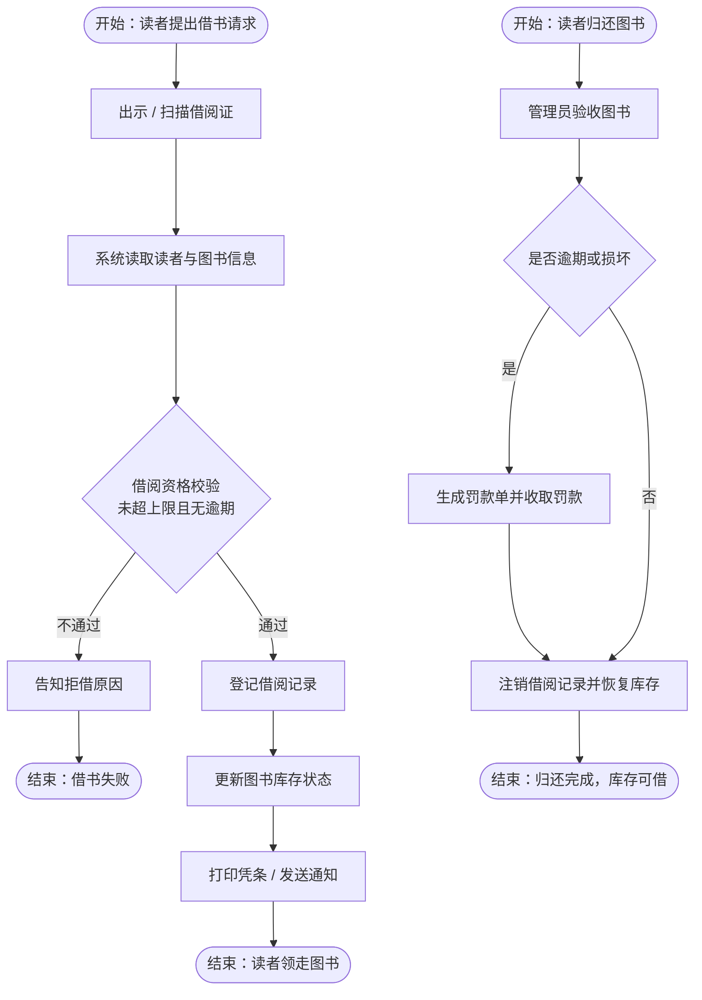
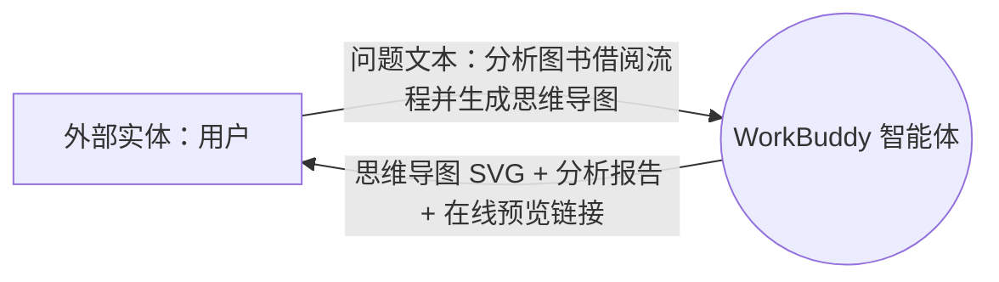
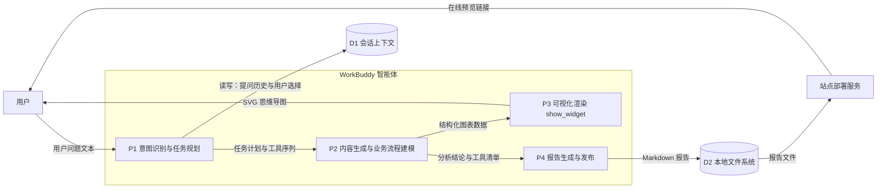
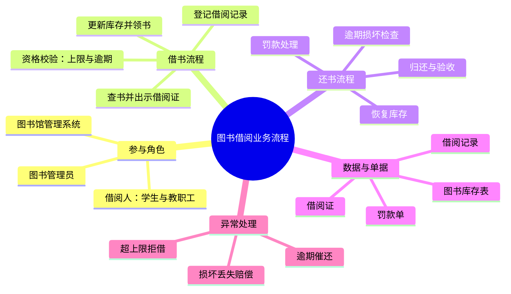

# 业务流程与数据流分析报告

> 基于 WorkBuddy 智能体真实运行过程的观察记录

---

## 〇、报告基本信息

| 项目            | 内容                                |
| ------------- | --------------------------------- |
| **作业名称**      | 使用智能体进行业务流程分析与数据流分析               |
| **项目名称**      | 高校图书馆图书借阅业务流程分析（智能体运行过程实录）        |
| **课程 / 教材章节** | 《信息系统分析与设计》· 第 3 章 业务流程分析 / 数据流分析 |
| **使用的智能体**    | WorkBuddy 智能体（通用智能体，支持多工具调用）      |
| **分析对象**      | 高校图书馆图书借阅业务（借书流程 + 还书流程）          |
| **作业形式**      | Markdown 报告（含业务流程图、数据流图、工具调用清单）   |
| **完成日期**      | 2026-11-06                        |

> 说明：本报告中记录的全部工具调用均为本次真实运行产生的记录，未做任何虚构；图表由 Mermaid 语法绘制，可在 GitHub 等支持 Mermaid 的 Markdown 阅读器中直接渲染。

---

## 一、作业任务与向智能体提出的问题

### 1.1 任务说明

使用 WorkBuddy 中的一个具体智能体，就一个具体业务流程向它提问，并要求其生成思维导图；随后观察并记录整个运行过程中智能体调用的**所有工具**，最后画出整个运行过程的**数据流图**，并结合教材中"业务流程分析""数据流分析"的问题清单逐一作答。

### 1.2 实际提出的问题

> **"请分析高校图书馆的图书借阅业务流程，并生成思维导图。"**

提问后，智能体先通过交互问答工具确认了两个运行参数（业务分析对象、报告交付格式），再自主完成"分析建模 → 可视化 → 报告撰写 → 发布"的完整工作流。

---

## 二、业务流程分析（对应教材问题清单）

### 2.1 教材原始问题

1. 有哪些业务流程？各自目的或想达到的目标是什么？
2. 这个业务流程是如何完成的，有哪些任务并经过哪些步骤完成？活动执行（开始、结束）的条件？
3. 这个业务流程有谁参与？各自完成流程中的哪些活动？
4. 流程中有哪些控制流（如判断、同步分支与会合等）？多个不同流程之间有什么关系？
5. 流程用了哪些方式或手段来完成？
6. 完成任务所用的资源（物理、人力、知识）及其成本如何？流程各环节的增值作用如何？
7. 流程中是否存在瓶颈或阻塞排队现象？

### 2.2 逐题回答

**问题 1：有哪些业务流程？目标是什么？**

图书借阅业务包含两条核心流程与一条辅助流程：

- **借书流程**：目标是让符合条件的读者在最短时间内完成借阅，并留下可追溯的借阅记录；
- **还书流程**：目标是收回图书、核算逾期与损坏责任、恢复库存可用状态；
- **辅助流程（异常处理）**：处理超借阅上限、逾期未还、图书损坏或丢失等例外情况，保证账实一致。

**问题 2：流程如何完成？有哪些步骤？开始与结束条件？**

- 借书流程以"读者提出借书请求（出示借阅证）"为开始条件，依次经过：扫描借阅证 → 系统读取读者信息 → 借阅资格校验 → 登记借阅记录 → 更新库存状态 → 打印凭条或发送通知，以"读者完成登记并领走图书"为结束条件；
- 还书流程以"读者归还图书"为开始条件，经过：管理员验收 → 检查逾期与损坏 → 处理罚款（如有）→ 注销借阅记录、恢复库存，以"归还完成、库存可再次借出"为结束条件。

详细步骤与判断分支见 **第三节 业务流程图**。

**问题 3：有谁参与？各自完成哪些活动？**

| 参与者           | 角色类型 | 主要活动                         |
| ------------- | ---- | ---------------------------- |
| 借阅人（学生 / 教职工） | 外部实体 | 提出借书请求、出示借阅证、归还图书、缴纳罚款       |
| 图书管理员         | 执行者  | 验证证件、验收图书、办理登记与注销、开具罚款单      |
| 图书馆管理系统       | 处理者  | 读取读者信息、资格校验、生成借阅记录、更新库存、发出通知 |

**问题 4：有哪些控制流？多流程之间有什么关系？**

- **判断分支一**：借阅资格校验（未超上限且无逾期）→ 通过则继续登记，不通过则拒借并告知原因，两条分支各自结束；
- **判断分支二**：还书时的"是否逾期或损坏"→ 是则先进入罚款处理，再与"否"分支在"注销记录、恢复库存"处**会合**；
- **流程间关系**：借书流程产生的"借阅记录"是还书流程的输入依据；还书流程结束时恢复的库存，又成为下一次借书流程的前提。两者通过**借阅记录**与**库存数据**形成闭环。

**问题 5：流程用了哪些方式或手段？**

借阅证（身份识别手段）、图书馆管理系统（自动化校验与登记的 IT 手段）、罚款单（经济约束手段）、通知与凭条（凭证与告知手段）。

**问题 6：所用资源、成本与增值作用？**

- 资源：人力资源（管理员工时）、信息系统资源（终端、系统许可）、物理资源（图书、借阅证、凭条纸）；
- 成本：主要是人工工时与系统运维成本，高峰期人工环节成本显著上升；
- 增值作用：每个环节都在做一次"信息增值"——从"读者口头请求"这一原始数据，逐步加工为"经过校验、可追溯、账实一致的借阅记录"。

**问题 7：是否存在瓶颈或排队现象？**

存在。瓶颈集中在**人工验证与登记**环节：开学季、考试周借还书高峰时，管理员逐个扫描登记会造成排队。改进方向是引入自助借还机与预约取书柜，把校验与登记从人工前移到读者自助端。

---

## 三、业务流程图

要点：本例含两个判断节点、三次分支会合/结束，符合教材对"判断、同步分支与会合"控制流的描述。

---

## 四、智能体运行过程与工具调用清单

### 4.1 工具调用真实记录

| 序号 | 运行阶段   | 调用的工具                      | 输入数据                         | 输出数据                              |
| -- | ------ | -------------------------- | ---------------------------- | --------------------------------- |
| 1  | 需求澄清   | `AskUserQuestion`（交互问答）    | 2 个选择题：分析对象、交付格式             | 用户选择：图书馆借阅流程；Markdown 报告 + 在线链接   |
| 2  | 设计规范加载 | `widget_guidelines`（图表规范库） | `modules = ["diagram"]`      | 配色、尺寸、布局等图表规范                     |
| 3  | 可视化    | `show_widget`（内嵌可视化）       | 思维导图节点数据：中心节点 + 5 个分支        | SVG 矢量思维导图，渲染进对话                  |
| 4  | 报告生成   | `Write`（文件写入）              | 报告全文                         | `图书借阅业务流程分析-作业报告.md`              |
| 5  | 语法修订   | `Edit`（精确替换）               | 一行非法 Mermaid 语句              | 修正后的 Markdown（可正常渲染）              |
| 6  | 站点准备   | `Bash`（命令行）                | `mkdir` + `cp` 命令            | `report-site/` 目录及 `report.md`    |
| 7  | 页面生成   | `Write`                    | HTML 模板代码                    | `report-site/index.html`          |
| 8  | 技能加载   | `Skill`（发布为应用）             | 技能名                          | 站点发布规范与前置条件                       |
| 9  | 工具检索   | `ToolSearch`               | 工具名 `workbuddy_sites_deploy` | 该工具的完整参数 schema                   |
| 10 | 在线发布   | `workbuddy_sites_deploy`   | 目录、应用名、域名前缀、入口页              | `shareLink`，`verified = true`     |
| 11 | 成果交付   | `present_files`            | 发布产物路径                       | 预览卡片 / 交付面板                       |
| 12 | 过程归档   | `Write`                    | 当日工作日志                       | `.workbuddy/memory/2026-11-06.md` |
| 13 | 报告整理   | `Write`                    | 本报告全文                        | 本文件 `业务流程与数据流分析报告.md`             |

### 4.2 工具调用链的观察结论

1. **工具是分层的**：规范类工具（`widget_guidelines`）在前，执行类工具（`show_widget`、`Write`）在后，发布类工具（`workbuddy_sites_deploy`）最后，形成"先取规则、再产出、再交付"的顺序；
2. **存在真实的失败与自我修正**：第 5 步由 `Edit` 完成——上一版报告中一行 Mermaid 语句语法非法（误用了双向箭头写法），智能体发现问题后精确替换修正，说明运行过程具备"检查—修正"闭环；
3. **工具之间有依赖**：`widget_guidelines` 的输出直接约束 `show_widget` 的输入；`Write` 必须先于 `Bash` 的复制与 `deploy`，否则上传的是空目录。

---

## 五、数据流图

### 5.1 顶层数据流图（Context Diagram）

### 5.2 一层数据流图（智能体运行过程分解）

### 5.3 数据流分析（对应教材问题清单）

**问题 1：系统作为信息处理器主要完成什么功能？最重要的输入和输出数据是什么？**

主要功能是"自然语言问题 → 结构化分析成果"的加工：接收问题文本，完成业务建模、图表化与文档化。最重要的输入是用户问题文本；最重要的输出是思维导图（SVG）、Markdown 报告与预览链接。

**问题 2：系统作为整体，与外界环境存在什么关系？**

用户是唯一外部实体：向系统提供问题与选择（输入流），从系统接收图表、报告与链接（输出流）。部署服务是外部协作方，接收报告文件、返回可访问链接。

**问题 3：系统功能复杂，能否分解为相对独立又联系的子系统？**

可分解为四个相对独立的加工：P1 意图识别与任务规划、P2 内容生成、P3 可视化渲染、P4 报告生成与发布。四者通过"任务计划 → 图表数据 → 文本数据"的顺序数据流相连。

**问题 4：分解后的子功能是否仍复杂，还能否再分？**

可以。例如 P2 可再分为三个子功能：业务流程建模（角色、步骤、控制流）、工具调用清单整理、数据流图绘制；P4 可再分为文档组装与站点发布两个子功能。

**问题 5：每个功能或子功能的输入数据和输出数据是什么？**

| 加工           | 输入数据            | 输出数据               |
| ------------ | --------------- | ------------------ |
| P1 意图识别与任务规划 | 用户问题文本、用户选择项    | 任务计划、工具调用序列        |
| P2 内容生成      | 任务计划、会话上下文      | 业务流程模型、工具清单、分析结论   |
| P3 可视化渲染     | 结构化节点与连线数据、图表规范 | SVG 图形（思维导图 / 流程图） |
| P4 报告生成与发布   | 分析结论、工具清单、图表    | Markdown 文件、在线预览链接 |

**问题 6：系统中需要长期保存的数据有哪些？如何创建、修改和使用？**

两类：一是**报告类文档**（Markdown 文件），由 `Write` 创建、由 `Edit` 修改、由读者在仓库或预览页使用；二是**会话上下文与工作日志**，由系统自动记录，用于跨轮次理解与后续追溯。

**问题 7：在一个业务流程中，数据来源到最后去处是否完整？**

完整。数据从"用户问题文本"这一唯一来源出发，经 P1→P2→P3/P4 逐级加工，最终以图形、文件、链接三种形态全部回流给用户；每个数据存储均有写入方与读取方，没有"只产出不消费"的孤立数据，也没有"无来源"的凭空数据。

---

## 六、思维导图（智能体运行成果）

---

## 七、总结与改进建议

### 7.1 总结

1. 本次作业完整走通了"提问 → 智能体分析 → 工具调用 → 成果交付"的链路，共记录到 **13 次工具调用**，覆盖交互、规范、绘图、文件、发布、展示六类能力。
2. 从业务流程分析看，图书借阅是一个"两判断、一会合、双流程闭环"的典型事务型流程，瓶颈在人工验证与登记环节，增值点在于把读者请求转化为可追溯的合规借阅记录。
3. 从数据流分析看，智能体系统可清晰分解为四个加工与两个数据存储，数据来源与去处闭合，符合数据流图的一致性检验要求。
4. 运行过程中出现过一次真实的语法错误并由智能体自行修正，说明"产出—校验—修正"是智能体工作流中不可省略的一环。

### 7.2 改进建议

| 对象     | 问题         | 改进建议                                            |
| ------ | ---------- | ----------------------------------------------- |
| 图书借阅业务 | 高峰排队、人工登记慢 | 引入自助借还机与预约取书柜；在系统中前置资格校验，减少柜台判断时间               |
| 图书借阅业务 | 逾期提醒不及时    | 增加到期前自动通知与线上续借，把"催还"从被动变主动                      |
| 智能体工作流 | 首轮产出存在语法错误 | 在生成图表代码后增加一次自动语法校验，把修正环节前移                      |
| 智能体工作流 | 分析结论偏通用    | 补充本馆实际规则（借阅上限、借期、罚款标准）作为约束输入，提高结论针对性            |
| 本报告    | 图表渲染依赖外部环境 | 在仓库 README 中注明"需支持 Mermaid 的阅读器查看"，并附在线预览链接作为兜底 |

###
